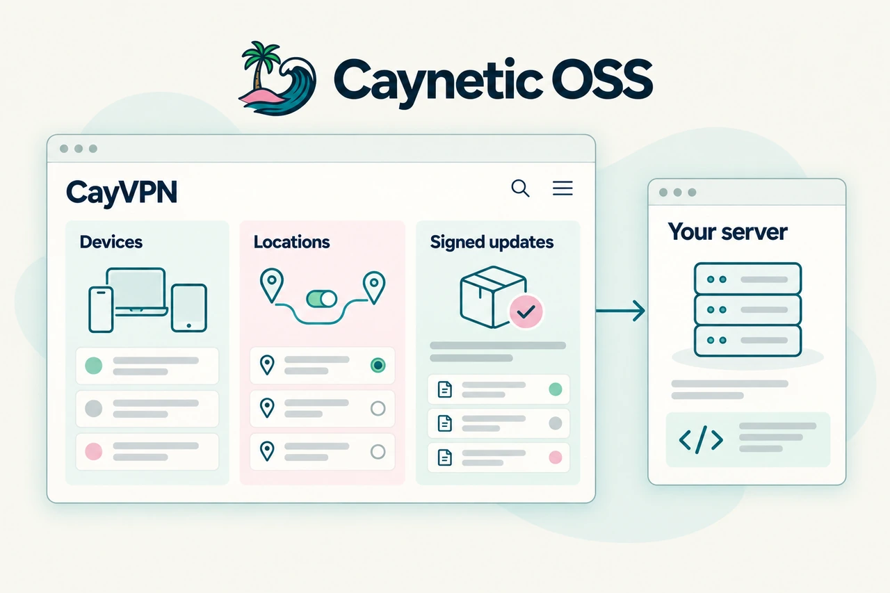
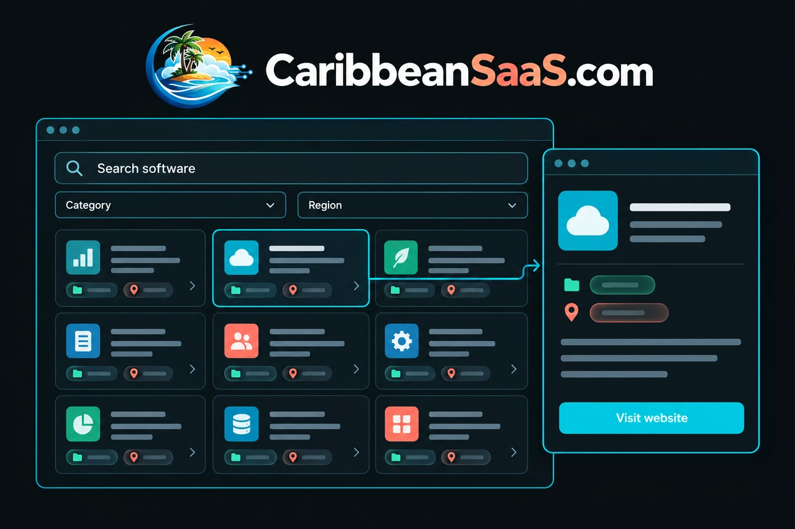

# Caynetic

**Practical technology, built in The Bahamas. 🇧🇸**

We build software, automation, and technology products for businesses and communities across the Caribbean. Our work includes custom web applications, SaaS, integrations, AI, and security reviews.

## Featured projects

| Project | What it does | Explore |
| --- | --- | --- |
| **CayVPN**  | A self-hosted VPN manager for Ubuntu, with WireGuard, a private web panel, and DNS controls. | [Code](https://github.com/caynetic/cayvpn) · [Project site](https://oss.caynetic.com/vpn) |
| **Serve the Cays**  | A Bahamian community directory for finding organisations, events, and ways to get involved. | [Code](https://github.com/caynetic/stc) · [Website](https://servethecays.com) |
| **CaribbeanSaaS**  | A curated directory for discovering software products built across the Caribbean. | [Code](https://github.com/caynetic/caribbeansaas) · [Website](https://caribbeansaas.com) |

Project illustrations from [Caynetic.com](https://caynetic.com/#products).

## More from Caynetic

* [CayneticVPN](https://cayneticvpn.com): our managed VPN project, separate from self-hosted CayVPN.
* [CaribTrends](https://caribtrends.com): Caribbean search and market intelligence.
* [Caynetic OSS](https://oss.caynetic.com): our open-source projects and documentation.

## Work with us

Based in Nassau, serving the Caribbean and beyond. Founded by [Christopher Klein](https://christopherklein.dev).

[caynetic.com](https://caynetic.com) · [Technology services](https://tech.caynetic.com) · [hello@caynetic.com](mailto:hello@caynetic.com)
